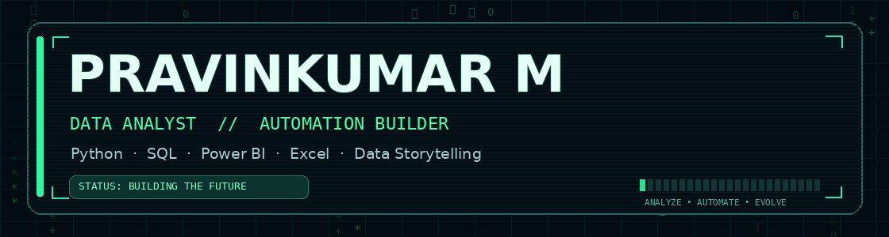

<div align="center">



### Data Analyst • Python Automation • Business Intelligence

**I turn raw data into clear decisions, dashboards, and faster workflows.**

[](https://github.com/PRAVINKUMAR-2917)
[](https://resume-pravinkumar.streamlit.app/)
[](https://pravinkumar-2917.github.io/PRAVINVERSE/)

</div>

---

## `> launch --pravinverse`

<div align="center">

### 🚀 PRAVINVERSE — My Interactive Hacker Universe

**One desktop. Multiple worlds. Endless possibilities.**

♟️ **Chess Arena** • 🧩 **Sudoku Lab** • 📊 **Data Analytics**  
💻 **Hacker Terminal** • 🏆 **Achievements** • 🔐 **Secret Missions**

### [⚡ ENTER PRAVINVERSE — LAUNCH LIVE WEBSITE ⚡](https://pravinkumar-2917.github.io/PRAVINVERSE/)

*Explore my skills and projects through an interactive, hacker-inspired desktop experience.*

[](https://github.com/PRAVINKUMAR-2917/PRAVINVERSE)

</div>

---

## `> whoami`

I'm **Pravinkumar M**, a **Data Analyst** based in Mumbai, India. I work on business reporting, KPI dashboards, CRM analytics, and workflow automation — especially with **Python, SQL, Power BI, and Advanced Excel**.

My focus is simple: **less repetitive reporting, more useful insight**.

```text
[ SYSTEM PROFILE ]
ROLE      : Data Analyst
FOCUS     : Analytics • Automation • Business Intelligence
TOOLKIT   : Python / SQL / Power BI / Excel / Streamlit
PORTFOLIO : PRAVINVERSE
STATUS    : ONLINE
MODE      : Learn → Build → Improve
```

## `> tech --stack`

| Area | Toolkit |
| :--- | :--- |
| **Data analysis** | Python, Pandas, NumPy, SQL |
| **Business intelligence** | Power BI, DAX, KPI dashboards |
| **Spreadsheet engineering** | Advanced Excel, Power Query, Power Pivot, VBA |
| **Visualization & apps** | Streamlit, Matplotlib, Seaborn |
| **Business operations** | MIS reporting, CRM / TeleCRM, automation |

## `> projects --featured`

| Project | What it does |
| :--- | :--- |
| **[PRAVINVERSE](https://pravinkumar-2917.github.io/PRAVINVERSE/)** | Live interactive hacker portfolio featuring Chess, Sudoku, analytics, terminal commands, and achievements. |
| **BMW-Infinitycars Live MIS Dashboard** | Internal Streamlit/Python solution for recurring MIS reporting and KPI tracking. *Internal work; source/data not publicly shared.* |
| **Dynamic Attendance Tracker** | Excel and Power BI reporting workflow using Power Query. |
| **Blinkit Grocery Dashboard** | Excel-based sales and category analysis with interactive reporting. |
| **Road Accident Analysis** | Python and Power BI analysis of accident trends and hotspots. |

## `> experience --highlights`

- **BMW-Infinitycars, Worli** — analytics dashboards, MIS automation, business performance reporting, and TeleCRM operations.
- **Research AYU Company** — operational dashboards, CRM reporting, and recurring report automation.
- **Jeevan Ambulance** — Excel/VBA attendance and salary-reporting automation.
- **Diallo Company** — MIS reporting, data validation, and Excel workflow improvements.

## `> education`

- **BSc (Applied Science – Energy)** — Indira Gandhi National Open University *(ongoing)*.
- **Data Analyst program** — Masai School *(Jan–Jul 2025)*.

## `> current_mission`

```text
[01] Build thoughtful, real-world analytics tools       ██████████
[02] Make reporting more automated and reliable       ██████████
[03] Launch my interactive developer portfolio        ██████████
[04] Keep learning, experimenting, and improving       ██████████
```

## `> connect --online`

<div align="center">

**Explore my live portfolio, source code, and professional work.**

[🌐 Launch PRAVINVERSE](https://pravinkumar-2917.github.io/PRAVINVERSE/) • [💻 GitHub](https://github.com/PRAVINKUMAR-2917) • [📄 Live Resume](https://resume-pravinkumar.streamlit.app/)

---

**Thanks for visiting. Explore the work, follow the experiments, and stay curious.**

`// EOF — keep building`

</div>
